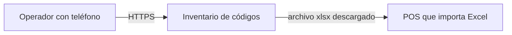
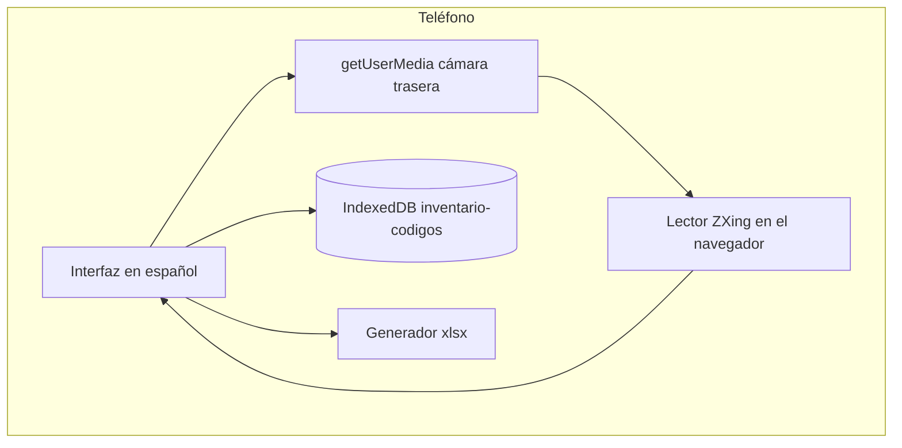

# Overview

## C4 — Contexto

## C4 — Contenedores

Un solo contenedor: sitio estático. El navegador guarda IndexedDB y genera el xlsx. No hay contenedor de servidor.

Módulos de código: `src/domain` (reglas), `src/camera` (restricción y errores), `src/persistence`, `src/export`, `src/ui`. La UI depende del dominio. El dominio no depende del navegador.
